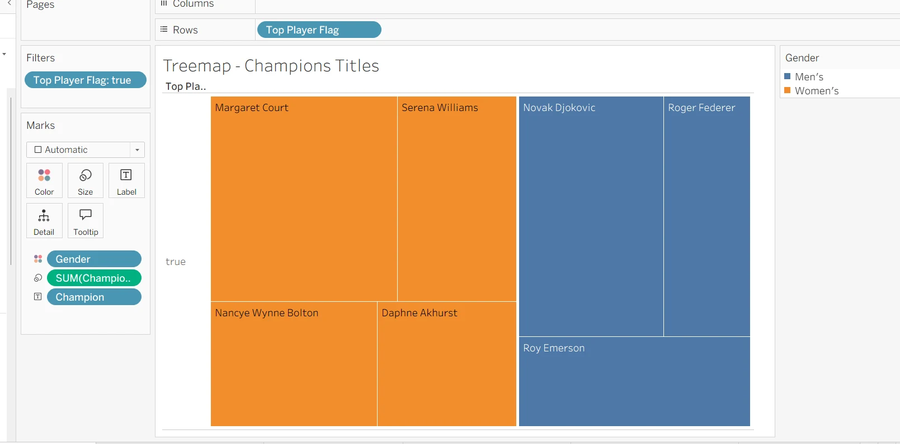

# Australian Open Visual Analytics | 澳网历史决赛分析

An individual Excel and Tableau project exploring historical final-match records through distribution, trend and multivariate views.

**[浏览图表与注解](https://leoz-svg.github.io/australian-open-analytics/) · [作品集](https://leoz-svg.github.io/ai-project-portfolio/)**



## 分析范围

依据个人 A2 报告：215 行男女单打决赛记录，报告覆盖年份为 1905–2026。每行是一场决赛，不是所有轮次比赛。

个人工作包括数据整理、缺失值处理、计算字段设计、Tableau 图表与分析报告。技术为 Excel、Tableau；AI 仅辅助部分缺失时长的估计，未开发大模型 API、Agent 或预测服务。

## 展示内容

- 冠军次数树状图；时长趋势；国籍地图。
- 多变量散点图；局数获胜占比柱状图；平行坐标。
- 冠亚军国籍对照；每张图的用途、编码与解读边界。

`docs/assets/` 为原 A2 报告中的图表截图。网页通过按钮切换真实图表，**不是在线 Tableau 工作簿**。原始 Excel / .twb / .twbx 文件未随材料提供，故未伪造底层数据或原生交互。

## 指标定义

| 字段 | 口径 |
|---|---|
| Champion Titles | 该样本中选手夺冠次数 |
| Top Player Flag | 五次及以上夺冠者 |
| Games Won | 对应记录中各盘赢局数之和 |
| Games Played | 各盘赢局与输局总和 |
| Win Rate（报告命名） | Games Won / Games Played，实为局数获胜占比 |

局数占比不等于比赛胜率或球员生涯胜率。“逐场比例的平均”与“总赢局数/总局数”也不是同一统计口径。

## 数据与结论边界

原报告部分时长通过历史记录及 AI 辅助估计补齐。复盘应保留来源和缺失标记、区分估计与观测，并做包含/排除估计值的敏感性比较。男女赛制、退赛和无比赛记录影响平均时长，不能仅凭时长解释球员能力。地图统计冠军次数，不一定是独立获冠人数。

本展示没有另行核验全部历史比赛记录，不把 AI 估计值作为已核实事实。源报告中的部分强解释性结论在网页中改为更明确的描述性分析边界。

## 本地查看 / GitHub Pages

```sh
python -m http.server 8000 --directory docs
```

浏览 http://localhost:8000。GitHub Pages 使用 `main` 分支的 `/docs`。页面无外部服务依赖，不上传访客数据。图表和分析保留原项目作者权利。
